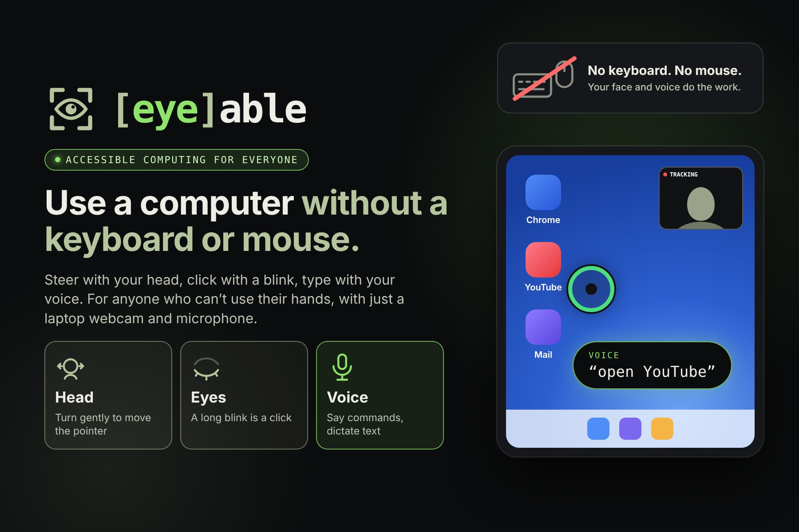
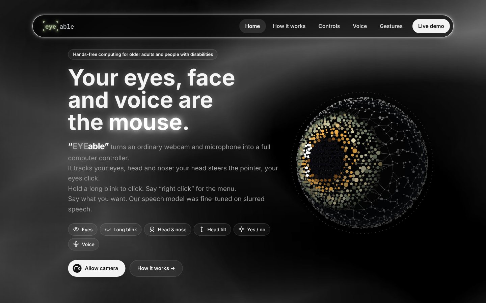
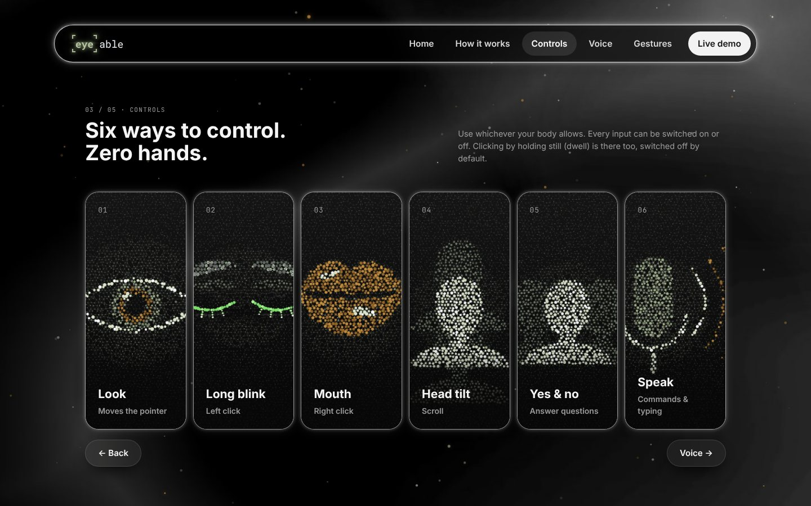
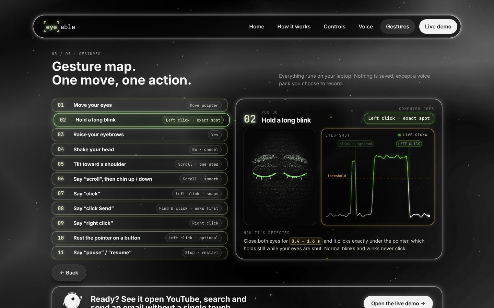
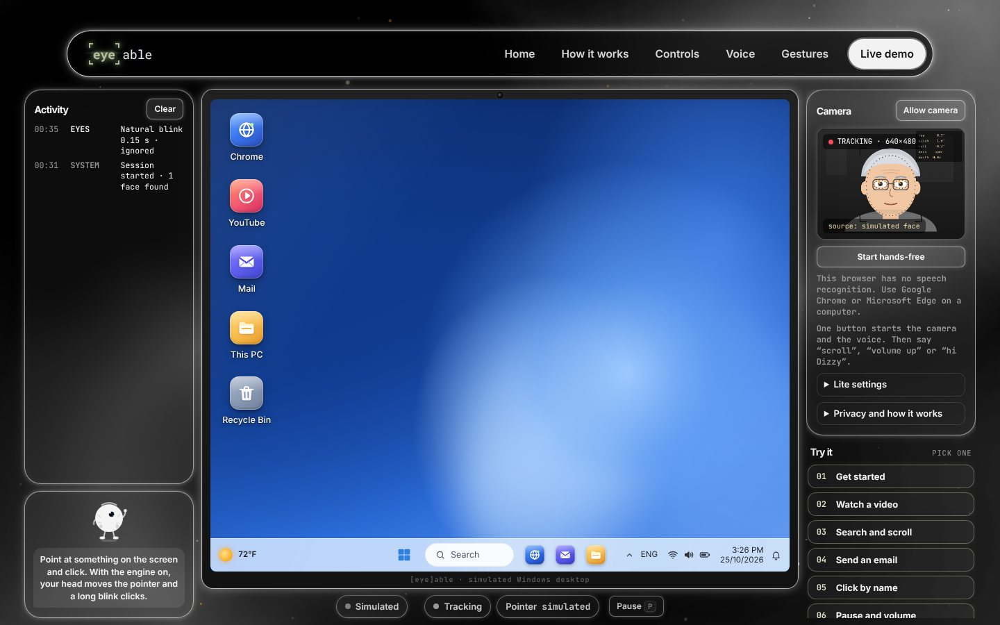
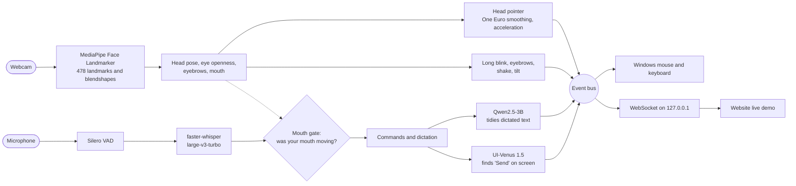
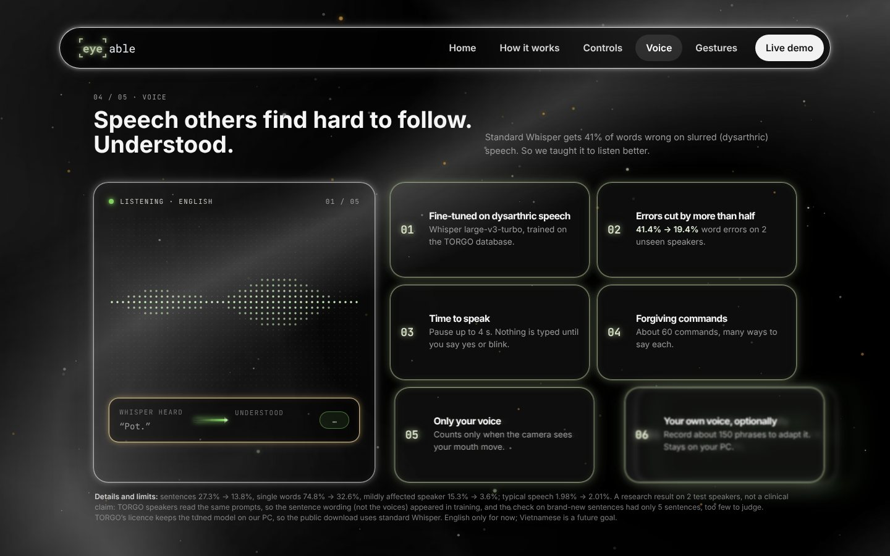

<p align="center">
  
</p>

<p align="center">
  <a href="https://phuc-khanq.github.io/-eye-able/"><b>Website</b></a> ·
  <a href="https://phuc-khanq.github.io/-eye-able/#demo"><b>Live demo in your browser</b></a> ·
  <a href="#install-on-windows"><b>Install on Windows</b></a> ·
  <a href="#how-it-works"><b>How it works</b></a> ·
  <a href="#results-speech-that-others-find-hard-to-follow"><b>Results</b></a>
</p>

# [eye]able

**Control your whole computer hands-free, with nothing but a webcam and a microphone.** Your head moves the pointer, a long blink clicks, and your voice runs commands and types. Say "click Send" and UI-Venus 1.5 finds that button on the screen for you.

Computers still assume two working hands. For people living with ALS, spinal cord injuries, cerebral palsy, muscular dystrophy or a severe tremor, reading an email or sending a message can mean waiting for someone else. Almost every laptop already has a webcam and a microphone, so [eye]able uses only those: no extra hardware, nothing to wear, and nothing leaves the laptop.

Built in 48 hours at **Gator Hack V** (UF AI Days 2026) by Khang, Khoi, Khoa, Hung and Nhi.

## What you can do

| You do | The computer does |
| --- | --- |
| Turn your head | Moves the pointer like a mouse: small turns aim finely, quick turns travel far |
| Look where you want to go *(optional mode)* | Your eyes pull the pointer toward that spot; your head does the last, precise bit |
| Hold a long blink, 0.4 to 1.6 s | Left click, exactly under the pointer. Normal blinks and winks never click |
| Raise your eyebrows | Yes: confirms a question or types the dictated text |
| Shake your head (while dictating) | No: drops the dictated text |
| Tilt toward a shoulder | Scrolls one step up or down |
| Say "scroll", then lift or lower your chin | Smooth scrolling, faster the further you move |
| Say "hi Dizzy", talk, then "bye" | Dictation, with a live preview of what will be typed |
| Say "click Send" | UI-Venus 1.5 finds the button, highlights it and clicks after your yes |
| Say "click", "right click", "open YouTube", "volume up", "pause" | About 60 voice commands, each with many ways to say it |

Anything risky asks first, and a question nobody answers counts as "no" after 12 seconds. Saying "pause" stops everything except "resume" and "quit", so you can rest or look around freely.

## Try it

**In your browser, no install:** open the [live demo](https://phuc-khanq.github.io/-eye-able/#demo) in Chrome or Edge and press **Start hands-free**. Face tracking runs inside the page (MediaPipe), and you drive a simulated Windows desktop with your head, long blinks and voice: open YouTube, search, write and send an email. The camera picture stays in your browser tab.

**On your own PC:** install the Windows app below. It moves the real Windows pointer, clicks and types in any app.

| | |
| --- | --- |
|  |  |
|  |  |

On your PC, a small card at the top of the screen shows what the microphone heard and what will be typed, and waits for your yes before anything risky happens.

## How it works



- **Engine:** one Python 3.11 program. Each part (camera, pointer, gestures, voice, screen understanding) talks to the others only through an event bus, so five people could build in parallel and any part can be swapped for a stub in tests.
- **Pointer:** a relative "head mouse" with speed-based acceleration and One Euro smoothing. There's no fixed center, so leaning back in the chair doesn't drift it. The optional eye pull uses a one-look calibration.
- **Voice:** faster-whisper with voice activity detection. The **mouth gate** keeps a word only if the camera saw *your* mouth moving while it was said, so other people talking in the room never type into your email.
- **Click by name:** for "click Send", UI-Venus 1.5 (2B) reads a screenshot, finds the element, and the click waits for your yes.
- **Website:** plain HTML, CSS and JavaScript on GitHub Pages, no build step. When the engine runs on the same PC, the live demo connects to it over a local WebSocket and becomes the engine's screen.
- **Tests:** over 900 automated tests, plus browser checks for the website.

### Built to avoid mistakes

Hands-free control lives or dies on accidental actions, so every gesture has a threshold, a hold time and a way back:

- **Webcam gaze is not precise.** Measured on our calibration, it lands about 170 px from where you look, so the head is the precise pointer and the eyes are only an optional pull.
- **Looking down looks like a blink.** The "eyes open" level is learned separately for each head angle, closes that never fully shut are dropped, and the pointer holds still while your eyes are closed.
- **Talking moved the face.** An eyebrow click and a mouth-open right click both fired during speech, so eyebrows became "yes" (never a click) and the mouth click is off by default.
- **A blink clicks where you are,** not where a model guesses: only the spoken "click" snaps to the nearest button.

## Results: speech that others find hard to follow

Standard speech recognition fails many people whose speech is affected by their condition. We fine-tuned Whisper large-v3-turbo with LoRA on the TORGO dysarthric speech database and tested it on two speakers it never heard in training.

| Test set | Standard Whisper | Our fine-tune |
| --- | --- | --- |
| Dysarthric speech, 801 clips from 2 unseen speakers | 41.4% word errors | **19.4%** |
| Sentences | 27.3% | **13.8%** |
| Single words | 74.8% | **32.6%** |
| Mildly affected speaker | 15.3% | **3.6%** |
| Typical speech (LibriSpeech) | 1.98% | 2.01% |



This is a research result, not a clinical claim. TORGO speakers read the same prompts, so the sentence wording (not the voices) appeared in training. TORGO is licensed for academic, non-profit use, so the tuned model stays on our PC and the public download uses standard Whisper. The training scripts are in [`engine/voice/finetune/`](engine/voice/finetune/).

## Privacy

Camera frames, audio and screenshots stay in memory on your PC and are never saved or sent anywhere. The only network use is downloading the models once. The website's demo processes the camera inside your browser tab.

## Install on Windows

**Needs:** Windows 10 or 11, a webcam, a microphone, internet for the first install, and 4 to 22 GB of disk (depends on your GPU, below). No Python or other setup needed.

1. Download `EYEable-<version>.zip` from [Releases](../../releases), or use the green **Code → Download ZIP** button, and unzip it anywhere, for example `Documents\EYEable`.
2. Double-click **`Install EYEable.bat`**. If Windows says "Windows protected your PC", click **More info → Run anyway** (the script isn't signed). It installs its own Python, the packages and the models into that folder, picks what your PC can run, and adds an **EYEable** shortcut to the Desktop and Start menu. Takes 10 to 40 minutes, mostly downloads.
3. Start [eye]able from the **EYEable** shortcut. Face the screen and look at its center for a second. Say "hi Dizzy" to dictate, "bye" to stop dictating, "quit" to close it.

| Your PC | Profile | What runs | Disk |
| --- | --- | --- | --- |
| NVIDIA with 16 GB (RTX 4080, 5080, 4090, 5090, 4060 Ti 16 GB) | `full` | Everything, as in our demo: head pointer, blink click, voice commands, dictation with live preview and clean-up, click by name | about 22 GB |
| NVIDIA with 12 GB | `gpu12` | All of it except the dictation clean-up (your own words are typed) | about 14 GB |
| NVIDIA with 8 GB | `gpu8` | All of it except click by name; a smaller clean-up model | about 14 GB |
| No NVIDIA card (most laptops) | `cpu` | Head pointer, blink click, voice commands and dictation (Whisper small on the CPU: slower, less accurate) | about 4 GB |

The installer picks the profile for you; `scripts\setup.ps1 -Profile cpu` forces one.

If it doesn't start, run `scripts\preflight.ps1` (right-click → Run with PowerShell). It checks that the camera isn't busy, the GPU has room, the microphone works and the files are complete, and says what to fix. Camera or microphone blocked: Windows Settings → Privacy & security → Camera / Microphone → turn on "Let desktop apps access". To uninstall, delete the folder and the shortcuts; the models are in `%USERPROFILE%\.cache\huggingface\hub`.

## Run

| What | How |
| --- | --- |
| The app (moves the real pointer) | `EYEable.bat`, or `.\scripts\run_demo.ps1` |
| The website with the real engine | `EYEable Website.bat`, then **Live demo → Allow camera** (it starts the engine) |
| The engine on its own | `.\.venv\Scripts\python.exe -m engine.main` (`--help` lists the options) |
| Website work without a camera | `.\.venv\Scripts\python.exe -m tests.fake_engine` |
| Checks before a demo | `.\scripts\preflight.ps1` |

The pointer mode is `head` by default. `--pointer head-eyes` adds the eye pull, and `--pointer head-push` is a paused experiment kept as an option.

<details>
<summary><b>Developer setup</b></summary>

Needs Python 3.11, Git, and an NVIDIA GPU for the full profile (RTX 50-series needs the CUDA 12.8 PyTorch build, which the script installs). Node.js 20 or newer only for the website's JavaScript tests.

```powershell
Set-ExecutionPolicy -Scope Process Bypass
.\scripts\install.ps1            # demo laptop; add -CpuOnly on a laptop without an NVIDIA GPU
```

The script creates `.venv`, installs PyTorch and `requirements.txt`, and downloads the MediaPipe face model to `models/`. UI-Venus and Whisper download to the Hugging Face cache the first time they run.

Run the tests:

```powershell
.\.venv\Scripts\python.exe -m unittest discover -s tests -t .
node --test tests/lite_core.test.js tests/lite_voice.test.js
```

**Read [`CONTRIBUTING.md`](CONTRIBUTING.md) before your first commit.** `main` is the release: the installer zip, the hosted website and the demo laptop all come from it. Shared contracts live in `engine/core/types.py` and `engine/core/messages.py`; tell the team before changing either one.

</details>

## What's in this repository

```text
engine/
  eyes/         camera, face landmarks, head pointer, blink and head gestures, Windows mouse and keyboard
  voice/        microphone, Whisper, commands, dictation, clean-up; finetune/ has the TORGO training scripts
  core/         event bus, modes, message contracts, the WebSocket relay
eyeable-frontend/eyeable-frontend/
                the website and live demo (plain HTML, CSS and JavaScript)
scripts/        installer, launcher, pre-demo checks, release zip
tests/          unit tests and browser checks
docs/
  brand/        logo and app icon (SVG, PNG, ICO)
  media/        the pictures in this README
```

## Limits

- Webcam tracking is less precise than a dedicated eye tracker, which is why the head does the precise pointing.
- We have not yet tested with people who have motor or speech disabilities. That is our first next step.
- Windows only for now: the overlay and the clicking use Windows APIs. English only.
- The full version needs a 16 GB NVIDIA GPU; ordinary laptops get a smaller CPU version.

## Team

Built at Gator Hack V by **Khang, Khoi, Khoa, Hung and Nhi**.

| Route | Main engineer | Helpers | Code |
| --- | --- | --- | --- |
| Eyes, cursor and UI-Venus | Khang | Hung | `engine/eyes/` |
| Voice, dictation and control | Khoi | Khoa | `engine/voice/`, `engine/core/` |
| Website, UI and live demo | Nhi | Hung, Khoa | `eyeable-frontend/eyeable-frontend/` |

### Who built what

- **Khang** built the eyes side: the head-driven pointer with acceleration and smoothing, the long-blink click, eyebrow yes and head-shake no, tilt scrolling, the UI-Venus "click by name" step, and the Windows installer and scripts. He also connected the engine to the website's live demo, ran the speech fine-tune evaluation, and kept the repository together.
- **Khoi** built the voice and control side: the mode manager, voice commands (open apps and sites, pause, resume), dictation with the live preview, the WebSocket relay, the training scripts, and most of the automated tests for them.
- **Khoa** worked on the speech model: the LoRA fine-tune on dysarthric speech, the benchmarks against stock Whisper, the live microphone checks, and the CPU fallback for computers without an NVIDIA GPU. He also did integration and testing across the team.
- **Hung** shaped the head-gesture timing for slow webcams, ran teammate tests and collected feedback, and wrote the pitch, slides, demo video and Devpost story.
- **Nhi** designed the website and its look: the landing page, the Controls, Gestures and Voice pages, the colors, and the interface the live demo uses.

The git history shows commits from Khang, Khoi, Khoa and Hung; Nhi's design work came in from her own branch and was merged into the site by Khang. We also used Claude as a coding assistant, and its commits are marked as such.

## Third-party models and data

- UI-Venus 1.5 (Ant Group): Hugging Face lists Apache 2.0; the GitHub page says research and educational use only.
- MediaPipe Face Landmarker (Google): Apache 2.0.
- Whisper weights (OpenAI) via faster-whisper: MIT.
- Qwen2.5-3B-Instruct (Alibaba Qwen), for the dictation clean-up: Qwen Research License (free for research; commercial use needs permission from Alibaba).
- TORGO dysarthric speech database (University of Toronto), used only in `engine/voice/finetune/` to adapt Whisper: free for academic, non-profit use; cite Rudzicz, Namasivayam and Wolff (2012). The data and adapted model are never committed. See `engine/voice/finetune/DATA.md`.
- LibriSpeech (Panayotov et al., 2015), CC BY 4.0, for checking typical speech.

## License

Our code is MIT licensed. See [`LICENSE`](LICENSE).
